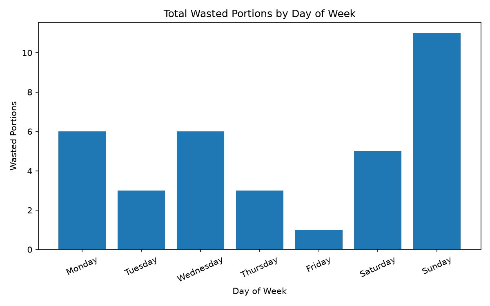
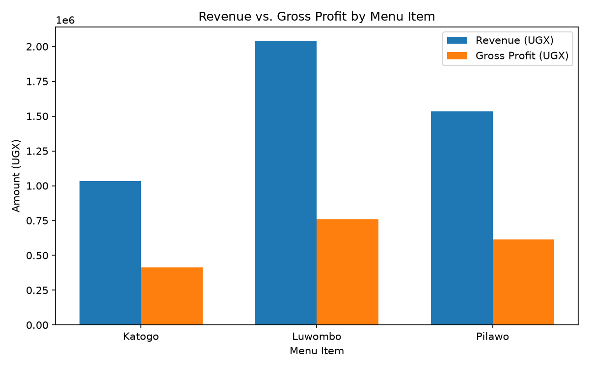

# Local Restaurant Daily Sales & Waste Analysis (Sample Case Study)

## 1. Business Question
How do daily revenue, gross margin, and food waste vary across menu items and days of the week—and where can prep quantities be adjusted to cut waste without losing peak-day sales?

## 2. Dataset Overview
- **File:** `daily_sales_sample.csv` (21 records covering 7 days across 3 menu items)
- **Columns:** `date`, `day_of_week`, `item`, `portions_sold`, `unit_price_ugx`, `prep_cost_ugx`, `waste_portions`

## 3. Data Cleaning & Audit
- **Missing Value Check:** Found 1 missing `portions_sold` entry (`2026-11-04`, Luwombo). Since `prep_cost_ugx` was `120,000 UGX` and standard unit prep cost is `7,500 UGX` (`135,000 / 18`), estimated total prepared portions = `16`, minus `1` wasted portion = **15 portions sold**.
- **Outlier Check:** Sunday Pilawo recorded `5` wasted portions (18.5% of prepared units), notably higher than the weekday average.

## 4. Key Findings (Cleaned Data)
| Menu Item | Total Portions Sold | Total Revenue (UGX) | Total Prep Cost (UGX) | Gross Profit (UGX) | Gross Margin | Waste Rate |
| :--- | :---: | :---: | :---: | :---: | :---: | :---: |
| **Katogo** | 258 | 1,032,000 | 619,200 | 412,800 | 40.0% | 4.8% |
| **Luwombo** | 170 | 2,040,000 | 1,282,500 | 757,500 | 37.1% | 3.4% |
| **Pilawo** | 219 | 1,533,000 | 919,800 | 613,200 | 40.0% | 6.8% |
| **Total** | **647** | **4,605,000** | **2,821,500** | **1,783,500** | **38.7%** | **5.1%** |

- **Peak Demand:** Friday and Saturday generate **41.5%** of total weekly revenue (`1,910,000 UGX`).
- **Profit Driver:** Luwombo brings in the highest gross profit (`757,500 UGX`) despite selling fewer portions than Katogo or Pilawo.
- **Sunday Over-Prep:** Sunday shows the highest waste across Katogo (`4` portions) and Pilawo (`5` portions), suggesting batch sizes are still calibrated for Saturday demand.

## 5. Recommendations
1. **Reduce Sunday Pilawo and Katogo prep batches by ~15%** to cut end-of-day waste without risking stockouts.
2. **Enforce end-of-shift log validation** so missing portion counts are flagged before closing.

## 6. Next Steps
- Add a Python (`pandas` + `matplotlib`) script to automate the cleaning step and generate visual bar charts of daily revenue vs. waste.
  ''.
 ''.
